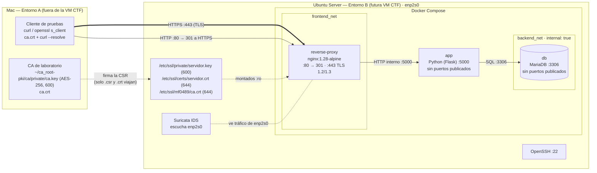

# Fase 1 — Arquitectura con HTTPS

Actualizo el diagrama de OpsMatrix (MF0488) para añadir HTTPS. Nginx pasa a ser el reverse proxy y el punto donde termina TLS. La CA del laboratorio se queda fuera de la VM.

## Resumen

| Criterio | Pts | Evidencia |
|---|---|---|
| F1.1 Nginx como entrada HTTPS y punto claro de terminación TLS | 0,20 | [Diagrama](#diagrama) · [Tramos](#tramos-con-tls-y-tramos-internos) |
| F1.2 CA fuera de la VM CTF; certificados y claves en su sitio | 0,15 | [Diagrama](#diagrama) · [Certificados y claves](#certificados-y-claves) |
| F1.3 Redes, app, BBDD, puertos y Suricata coherentes | 0,15 | [Puertos](#puertos) · [Qué ve Suricata](#qué-ve-suricata) |

## Conceptos

| Pieza | Qué es | Papel en OpsMatrix |
|---|---|---|
| **TLS** | Protocolo que cifra la conexión y autentica al servidor con un certificado | Protege el tramo cliente → servidor (HTTPS = HTTP dentro de TLS) |
| **Certificado X.509** | Documento firmado que une un nombre (`portal.opsmatrix.test`) con una clave pública | Lo presenta Nginx para demostrar que es el servidor legítimo |
| **CA** | Entidad que firma certificados. Si confías en la CA, confías en lo que firma | CA propia de laboratorio, en el Mac |
| **Nginx (reverse proxy)** | Servidor que recibe las peticiones y las reenvía a la app | Única puerta de entrada: termina TLS y pasa la petición a la app |
| **App** | El servicio que genera la respuesta | Mini app Python que lee y escribe en MariaDB |
| **MariaDB** | Base de datos | Guarda los datos; solo la ve la app |
| **Suricata** | IDS que analiza el tráfico de red | Vigila la interfaz de la VM por donde entra el cliente |

**¿Por qué este orden?** El cliente nunca habla directamente con la app ni con la BBDD. Siempre pasa por Nginx, que es el único que tiene el certificado y la clave. Así el cifrado, los logs y lo que está expuesto quedan en un solo sitio, y cada pieza solo ve lo que necesita (mínimo privilegio).

| Pregunta | Respuesta |
|---|---|
| ¿Por qué HTTPS y no HTTP? | Con HTTP todo viaja en claro: usuario, contraseña y datos de clientes se leen con un `tcpdump` (se ve en la Fase 4). Y nada demuestra que el servidor sea el bueno, así que alguien en medio puede suplantarlo (MITM). HTTPS añade cifrado, integridad y autenticación del servidor |
| ¿Por qué TLS 1.2 y 1.3? | TLS 1.3 tiene un handshake más corto, solo admite cifrados AEAD y siempre usa claves de sesión nuevas (forward secrecy). TLS 1.2 se deja por compatibilidad con clientes más antiguos. 1.0 y 1.1 están obsoletos (RFC 8996) |

## Diagrama

`app` está conectada a las dos redes (`frontend_net` y `backend_net`). Nginx solo a `frontend_net`: no necesita llegar a la base de datos.

## Tramos con TLS y tramos internos

| Tramo | Protocolo | Red | Cifrado |
|---|---|---|---|
| Cliente → Nginx | HTTPS :443 | enp2s0 (red de la VM) | ✅ TLS 1.2 / 1.3 |
| Cliente → Nginx | HTTP :80 | enp2s0 | ❌ solo la redirección 301 |
| Nginx → app | HTTP :5000 | `frontend_net` (bridge Docker) | ❌ tráfico interno |
| app → MariaDB | MySQL :3306 | `backend_net` (`internal: true`) | ❌ tráfico interno, sin salida a internet |
| CSR / certificados Mac ↔ VM | scp | red de laboratorio | ✅ SSH |

TLS termina en Nginx. Dentro de Docker el tráfico va sin cifrar porque no sale de la VM y las redes están separadas. Con datos reales de clientes también cifraría estos tramos (TLS hacia MariaDB, por ejemplo), pero para el laboratorio lo dejo así y lo dejo escrito.

## Certificados y claves

| Archivo | Dónde vive | Quién lo usa | ¿En GitHub? |
|---|---|---|---|
| `ca.key` | Mac, `~/ca_root-pki/ca/private/` | Solo la CA para firmar | ❌ Nunca. No entra en la VM ni en la OVA |
| `ca.crt` | Mac y VM `/etc/ssl/mf0489/` | Clientes para verificar | ✅ Público |
| `servidor.key` | VM `/etc/ssl/private/` | Nginx (montado `:ro`) | ❌ Nunca |
| `servidor.csr` | VM → Mac | La CA para firmar | ✅ Público |
| `servidor.crt` | VM `/etc/ssl/certs/` | Nginx (montado `:ro`) | ✅ Público |

## Puertos

| Servicio | Puerto | Publicado en el host |
|---|---|---|
| OpenSSH | 22/TCP | ✅ |
| reverse-proxy (Nginx) | 80/TCP, 443/TCP | ✅ Única entrada web |
| app | 5000/TCP | ❌ Solo `expose` en la red Docker |
| db (MariaDB) | 3306/TCP | ❌ Solo en `backend_net` |

## Qué ve Suricata

Suricata sigue en el host escuchando `enp2s0`, la interfaz por la que entra el tráfico del cliente.

| Tráfico | ¿Lo ve? | Qué ve |
|---|---|---|
| HTTP :80 | ✅ | Petición en claro (método, ruta, cabeceras) hasta la redirección |
| HTTPS :443 | ✅ Parcial | IPs, puertos, handshake TLS, SNI. No ve rutas ni contenido |
| Nginx → app → MariaDB | ❌ | Va por los bridges de Docker, no por `enp2s0` |

Suricata no ve las rutas HTTPS porque van cifradas. Nginx sí las ve, porque es quien descifra. Por eso en la Fase 4 se cruzan las dos fuentes.

## Decisiones

| Decisión | Motivo |
|---|---|
| CA en el Mac, no en la VM | La VM se exportará como CTF. Si `ca.key` estuviera dentro, cualquiera que la descargue podría firmar certificados "de confianza" |
| Nginx como reverse proxy, no TLS en la app | Un solo punto con el certificado, los logs y los puertos publicados. La app no tiene que saber nada de TLS |
| Nginx solo en `frontend_net` | Mínimo privilegio: el proxy no necesita hablar con la BBDD. Si comprometen Nginx, no llegan directo a MariaDB |
| App nueva en Python | Antes Nginx devolvía un JSON fijo. Hace falta una app real que use MariaDB para demostrar que todo sigue funcionando detrás del proxy |
| Dominio `portal.opsmatrix.test` | `.test` está reservado para pruebas (RFC 6761) y no choca con dominios reales |
| TLS 1.2 y 1.3, nada más antiguo | TLS 1.0 y 1.1 están obsoletos (RFC 8996) |

## Dificultades

| Dificultad | Solución |
|---|---|
| En el compose del MF0488 (`layer3-services/docker`) Nginx estaba en las dos redes y devolvía un JSON fijo, sin app real. En la VM corría además otro compose distinto (ver [Fase 3](fase3-https-docker.md#2-antes-y-después)) | Rediseño: Nginx solo en la red web y una app nueva conectada a las dos redes |
| El README decía "TLS 1.3" pero `default.conf` permitía 1.2 y 1.3 | Se documenta TLS 1.2 + 1.3, que es lo que pide la rúbrica y lo que estará en la configuración |

## Normativa

| Referencia | Relación |
|---|---|
| ENS (RD 311/2022) mp.com.2 y mp.com.3 | Confidencialidad e integridad de las comunicaciones: TLS en el tramo externo |
| ENS mp.com.1 y mp.com.4 / ISO 27001 A.8.22 | Perímetro seguro y separación de flujos en la red: `frontend_net` y `backend_net` |
| ISO 27001 A.8.24 | Política de criptografía: algoritmos, tamaños de clave y custodia de claves privadas |
| RGPD art. 32 | Cifrado en tránsito para un portal con datos de clientes (gestoría) |
| CCN-STIC-807 | Guía del CCN sobre algoritmos criptográficos admitidos en el ENS |
