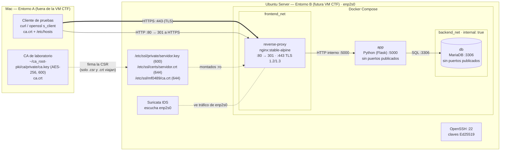

# Fase 1 — Arquitectura con HTTPS

Actualizo el diagrama de OpsMatrix (MF0488) para meter HTTPS: Nginx pasa a ser reverse proxy y punto de terminación TLS, y la CA del laboratorio se queda fuera de la VM.

## Diagrama

`app` está conectada a las dos redes (`frontend_net` y `backend_net`). Nginx solo a `frontend_net`: no necesita llegar a la base de datos.

## Tramos con TLS y tramos internos

| Tramo | Protocolo | Red | Cifrado |
|---|---|---|---|
| Cliente → Nginx | HTTPS :443 | enp2s0 (red de la VM) | ✅ TLS 1.2 / 1.3 |
| Cliente → Nginx | HTTP :80 | enp2s0 | ❌ solo la redirección 301 |
| Nginx → app | HTTP :5000 | `frontend_net` (bridge Docker) | ❌ tráfico interno |
| app → MariaDB | MySQL :3306 | `backend_net` (`internal: true`) | ❌ tráfico interno, sin salida a internet |
| CSR / certificados Mac ↔ VM | scp | red de laboratorio | ✅ SSH |

TLS termina en Nginx. Lo de dentro de Docker va en claro porque no sale del host y las redes están separadas. En producción con datos personales podría cifrarse también (mTLS o TLS hacia MariaDB).

## Certificados y claves

| Archivo | Dónde vive | Quién lo usa | ¿En GitHub? |
|---|---|---|---|
| `ca.key` | Mac, `~/ca_root-pki/ca/private/` | Solo la CA para firmar | ❌ Nunca. No entra en la VM ni en la OVA |
| `ca.crt` | Mac y VM `/etc/ssl/mf0489/` | Clientes para verificar | ✅ Público |
| `servidor.key` | VM `/etc/ssl/private/` | Nginx (montado `:ro`) | ❌ Nunca |
| `servidor.csr` | VM → Mac | La CA para firmar | ✅ Público |
| `servidor.crt` | VM `/etc/ssl/certs/` | Nginx (montado `:ro`) | ✅ Público |

## Puertos

| Servicio | Puerto | Publicado en el host |
|---|---|---|
| OpenSSH | 22/TCP | ✅ |
| reverse-proxy (Nginx) | 80/TCP, 443/TCP | ✅ Única entrada web |
| app | 5000/TCP | ❌ Solo `expose` en la red Docker |
| db (MariaDB) | 3306/TCP | ❌ Solo en `backend_net` |

## Qué ve Suricata

Suricata sigue en el host escuchando `enp2s0`, la interfaz por la que entra el tráfico del cliente.

| Tráfico | ¿Lo ve? | Qué ve |
|---|---|---|
| HTTP :80 | ✅ | Petición en claro (método, ruta, cabeceras) hasta la redirección |
| HTTPS :443 | ✅ Parcial | IPs, puertos, handshake TLS, SNI. No ve rutas ni contenido |
| Nginx → app → MariaDB | ❌ | Va por los bridges de Docker, no por `enp2s0` |

Por eso el log de Nginx es la otra fuente: ve la petición ya descifrada (Fase 4).

## Decisiones

| Decisión | Motivo |
|---|---|
| CA en el Mac, no en la VM | La VM se exportará como CTF; si `ca.key` estuviera dentro, cualquiera podría firmar certificados de confianza |
| Nginx solo en `frontend_net` | Mínimo privilegio: el proxy no necesita hablar con la BBDD |
| App nueva en Python | Antes Nginx devolvía un JSON fijo; hace falta una app real que use MariaDB para probar que todo sigue funcionando detrás del proxy |
| Dominio `portal.opsmatrix.test` | `.test` está reservado para pruebas (RFC 6761) |

## Normativa

| Referencia | Relación |
|---|---|
| ENS (RD 311/2022) mp.com.2 / mp.com.3 | Protección de la confidencialidad e integridad en las comunicaciones → TLS en el tramo externo |
| ISO 27001 A.8.24 / A.8.20 | Uso de criptografía y seguridad de redes (segmentación) |
| RGPD art. 32 | Cifrado de datos en tránsito para un portal con datos de clientes |
