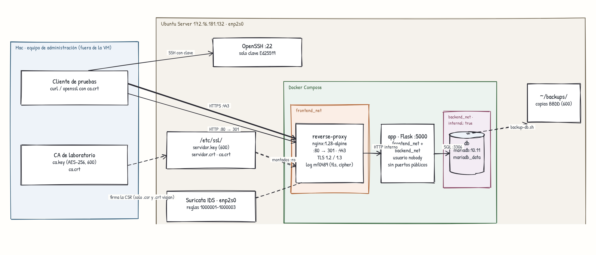

# Fase 5 — Entrega final

Último repaso de punta a punta. Aquí compruebo que lo documentado es lo que de verdad corre, que alguien puede montarlo sin mis claves y que se puede recuperar si algo falla. Todo se comprobó **después de reiniciar la VM** (20/10/2026).

## Resumen

| Comprobación | Resultado | Evidencia |
|---|---|---|
| Diagrama definitivo | ✅ | [arquitectura-final.png](arquitectura-final.png) |
| Despliegue que se usa de verdad | ✅ `docker-compose.yml` de la raíz, el único | [§2](#2-qué-corre-de-verdad) |
| Certificados instalados | ✅ | [§3](#3-certificados-y-claves) |
| Configuración coherente con el repo | ✅ Corregidas 4 diferencias | [§2](#2-qué-corre-de-verdad) |
| Recuperación | ✅ Copia restaurada y comprobada | [§4](#4-recuperación) |
| Reproducibilidad | ✅ Todo vuelve solo tras reiniciar | [§5](#5-reproducibilidad) |
| Claves privadas protegidas | ✅ | [§3](#3-certificados-y-claves) |
| `.gitignore` y lo publicado | ✅ Sin secretos | [§6](#6-qué-hay-publicado) |
| Confianza HTTPS, redirección, app y monitorización | ✅ | [§7](#7-pruebas-finales) |

## 1. Arquitectura final



Fuente editable: [arquitectura-final.mmd](arquitectura-final.mmd). Explicación de cada pieza en la [Fase 1](fase1-arquitectura.md) y la [guía](guia-despliegue.md).

## 2. Qué corre de verdad

**¿Coincide lo documentado con lo que hay en la VM?** Al principio no. Esto es lo que encontré y cómo quedó:

| Qué decía la documentación | Qué había en la VM | Ahora |
|---|---|---|
| Compose en `layer3-services/docker/` | Se usaba el de la raíz. El de `layer3` tenía contraseñas escritas | Un solo compose, contraseñas en `.env` (Fase 3) |
| Reglas de Suricata del repo (`[OPSMATRIX-NIDS]…`) | Corrían otras (`[SEC-ALERT]…`) | El repo tiene las que corren de verdad + la 1000003 (Fase 4) |
| "SSH solo con claves Ed25519" | `authorized_keys` **vacío** y `PasswordAuthentication yes` | Clave autorizada y contraseña desactivada (abajo) |
| Firewall en `rules.v4` | Solo reglas de Docker (44 líneas, 22 de ellas de bridges que ya no existen), ninguna propia | Desactivado `netfilter-persistent`. Docker crea sus reglas al arrancar |

**SSH.** Primero autoricé la clave del Mac (`ssh-copy-id`) y comprobé que entraba sin contraseña. Solo después instalé [`00-opsmatrix.conf`](../../layer2-perimeter/ssh/00-opsmatrix.conf). Se llama `00-` para que sshd lo lea antes que `50-cloud-init.conf`, que pone `PasswordAuthentication yes` (en sshd gana el primer valor que lee).

```
$ sudo sshd -T | grep -E "^(passwordauthentication|pubkeyauthentication|permitrootlogin) "
permitrootlogin no
pubkeyauthentication yes
passwordauthentication no

# desde el Mac
$ ssh -o BatchMode=yes server@172.16.181.132 "echo CLAVE OK"
CLAVE OK
$ ssh -o PubkeyAuthentication=no -o PreferredAuthentications=password server@172.16.181.132
server@172.16.181.132: Permission denied (publickey).
```

**Firewall y redes viejas.** `rules.v4` no protegía nada. Al arrancar volvía a cargar reglas de Docker de bridges que ya no existen. Lo guardé en `~/backups/`, desactivé `netfilter-persistent` y borré las 4 redes `docker_*` del compose antiguo (0 contenedores). Tras reiniciar: `reglas viejas cargadas: 0`.

Lo que protege los puertos ahora es la propia arquitectura: solo se publican 22, 80 y 443, y Docker pone sus reglas para las redes internas. Un firewall de host propio (nftables solo con 22/80/443 de entrada) queda como mejora.

## 3. Certificados y claves

| Archivo | Dónde | Permisos | Estado |
|---|---|---|---|
| `ca.key` | Solo Mac | 600, cifrada AES-256 | ✅ `OK: ningún ca.key en la VM` |
| `ca.crt` | Mac, VM, repo | 644 en la VM | ✅ Válida hasta 2036 |
| `servidor.key` | Solo VM, `/etc/ssl/private/` | 600 root, montada `:ro` | ✅ El hash coincide con el certificado |
| `servidor.crt` | VM y repo | 644 | ✅ `OK`, válido hasta el 19/10/2027 |
| `.env` | Solo VM | 600, en `.gitignore` | ✅ |

## 4. Recuperación

| Qué se pierde | Cómo se recupera |
|---|---|
| Configuración | `git clone` + `bash scripts/deploy.sh` |
| Datos de la BBDD | Copia de `scripts/backup-db.sh` en `~/backups/` |
| Certificado del servidor | Nueva clave y CSR, firmar otra vez con la CA |
| CA | CA nueva y reemitir el certificado del servidor |

**Prueba real de la copia** ([`backup-db.sh`](../../scripts/backup-db.sh)): hace la copia, la restaura en una base aparte (`restore_test`), cuenta las filas y la borra.

```
-rw------- 1 server server 865 Oct 20 09:40 /home/server/backups/opsmatrix-2026-10-20-0940.sql.gz
visitas en la BBDD buena:        9
visitas en la copia restaurada:  9
```

Pasos completos de recuperación y vuelta atrás en la [guía de despliegue](guia-despliegue.md#5-copias-y-recuperación).

## 5. Reproducibilidad

**¿Vuelve todo solo si se reinicia la VM?** Sí. Reinicié y, sin tocar nada:

| Comprobación tras el reinicio | Resultado |
|---|---|
| Contenedores | Los 3 `Up` (`restart: unless-stopped`) |
| `docker0` con IP | ✅ `172.17.0.1/16` (el fallo de la Fase 3 no se repitió) |
| Suricata | `active` |
| SSH | Entré con clave, sin contraseña |
| Datos | 10 visitas, la primera del 19/10 |
| Reglas viejas del firewall | 0 |

Para montarlo en otra máquina: [guía de despliegue](guia-despliegue.md). No necesita ninguna clave mía, cada uno genera la suya.

## 6. Qué hay publicado

```
.env  **/.env  **/*.key  **/private/  *.p12  *.pfx  *.pem  backups/  *.sql  *.sql.gz  *.ova  *.vmdk  *.iso
```

| Comprobación | Resultado |
|---|---|
| Claves, `.env` o copias en el repo | Ninguno (`git ls-files`) |
| Claves en todo el historial de git | Ninguna (`git log --all --name-only`) |
| Contraseñas en el historial | Las del compose antiguo de `layer3` (MF0488). No sirven: la BBDD se creó con las nuevas del `.env` |
| Público a propósito | `ca.crt`, `servidor.crt`, `servidor.csr`, `servidor.ext`, `.env.example` |

## 7. Pruebas finales

Salidas completas: [`check-vm-final.txt`](evidencias/fase5/check-vm-final.txt) y [`check-mac-final.txt`](evidencias/fase5/check-mac-final.txt).

| Prueba | Resultado |
|---|---|
| Confianza HTTPS | `codigo=200 tls=0`. `Verification: OK`, `Verified peername: portal.opsmatrix.test` |
| Sin la CA / con otro nombre | `exit 60` / `exit 60` |
| HTTP → HTTPS | `301`, `Location: https://portal.opsmatrix.test/prueba`, `Server: nginx` sin versión |
| TLS 1.3 / 1.2 / 1.1 | ✅ / ✅ / rechazado por el servidor (alerta 70) |
| App | `Visitas guardadas en MariaDB: 11`, `Has llegado por: https` |
| Puertos desde fuera | 22, 80 y 443 abiertos. 3306 y 5000 cerrados |
| Aislamiento | El proxy no ve la BBDD, la BBDD no sale a internet, la app corre como `nobody` |
| Monitorización | Suricata `active` en `enp2s0` con la regla 1000003 (Fase 4) |

### Cómo he probado (QA)

Cada cambio lo probé antes y después de llevarlo a la VM.

| Tipo de prueba | Qué hice | Dónde |
|---|---|---|
| Antes de desplegar (shift-left) | Nginx, la app y MariaDB montados en local: `nginx -t`, 301, TLS 1.3 y TLS 1.1 rechazado | Fase 3 |
| Validar la regla del IDS sin tocar la VM | Captura hecha a mano con un SYN normal, uno con ECN y un SYN-ACK, pasada por Suricata con `flags:S` y con `flags:S,CE` | Fase 4 |
| Pruebas de humo | `check-vm.sh` y `check-mac.sh` después de cada cambio | `scripts/` |
| Pruebas negativas | Sin CA, nombre equivocado, TLS 1.1, puertos 3306/5000, proxy → BBDD, BBDD → internet, SSH con contraseña. Todas tienen que **fallar** | Fases 3, 4 y 5 |
| Persistencia y recuperación | `down` / `up`, reinicio de la VM y copia restaurada en una base aparte | Fases 3 y 5 |
| Búsqueda de secretos | `git ls-files` y `git log --all` buscando `.key`, `.env`, `.pem` | Fase 5 |
| Coherencia docs = código | Cada directiva que nombran los docs, buscada con `grep` en el código | Fase 5 |
| Validación con herramientas | `shellcheck` (scripts), `pyflakes` (app), `docker compose config`, `nginx -t`, `suricata -T`, `sshd -t` y `openssl verify` con la CRL. Sin errores | Fase 5 |
| Revocación | Certificado de prueba revocado → `error 23`. El real sigue `OK` | [Extra](extras.md) |
| Automatizadas (CI) | `shellcheck`, `docker compose config`, `pip-audit` y `detect-secrets` en cada push | [`checks.yml`](../../.github/workflows/checks.yml) |

## 8. Dificultades de esta fase

| Problema | Solución |
|---|---|
| El README decía "solo claves Ed25519" pero `authorized_keys` estaba vacío | Autorizar la clave antes de quitar la contraseña, para no quedarme fuera |
| Un `00-opsmatrix.conf` con `PasswordAuthentication no` podía no aplicarse | `50-cloud-init.conf` lo pone a `yes`. Con el prefijo `00-` se lee antes. Lo comprobé con `sshd -T` |
| `rules.v4` cargaba reglas de Docker viejas al arrancar | Copia en `~/backups/`, `netfilter-persistent` desactivado y reinicio |
| `deploy.sh` apuntaba al compose borrado | Reescrito: comprueba los certificados, crea el `.env` y levanta el compose de la raíz |
| README con cosas que ya no eran ciertas ("solo TLS 1.3", "WAF") | Reescrito. Los documentos del MF0488 se quedan como historia y el README avisa de qué manda |

## 9. Pendiente (fuera de esta entrega)

| Mejora | Motivo |
|---|---|
| Firewall de host propio (nftables: entrada solo 22/80/443) | Hoy depende de lo que publica Docker |
| Aplicar las 68 actualizaciones de Ubuntu (4 de seguridad) | ISO 27001 A.8.8, gestión de vulnerabilidades |
| Renovar `servidor.crt` antes del 19/10/2027 | Caduca en un año |
| Cabecera HSTS en Nginx | Que el navegador no vuelva a intentar HTTP. No la puse porque con una CA de laboratorio puede dejar el dominio bloqueado en el navegador si algo falla |
| Revisar el proyecto `infra-lab` (WordPress) antes de exportar la OVA | No es de OpsMatrix, pero estará en la VM del CTF |

## Normativa

| Referencia | Relación |
|---|---|
| ISO 27001 A.8.13 / ENS mp.info.6 | Copias de seguridad hechas y restauradas para comprobarlas |
| ISO 27001 A.8.9 / ENS op.exp.3 | Configuración documentada igual a la real |
| ISO 27001 A.8.5 / ENS op.acc.6 | Autenticación SSH solo con clave |
| ISO 27001 A.8.24 | Custodia de claves: `ca.key` fuera de la VM |
| ISO 27001 A.8.8 | Parches pendientes anotados |
